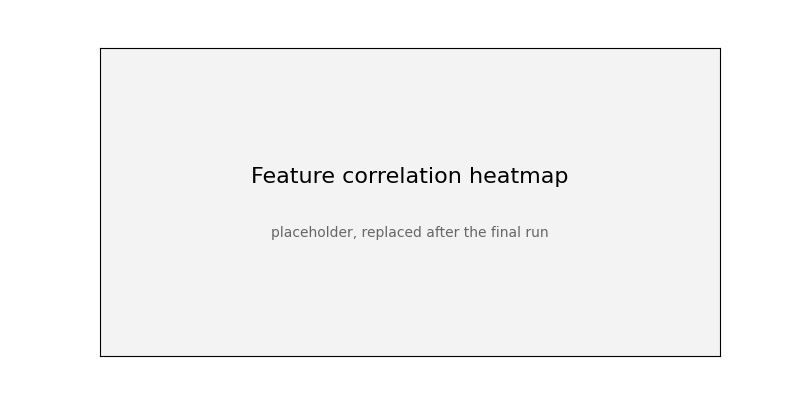
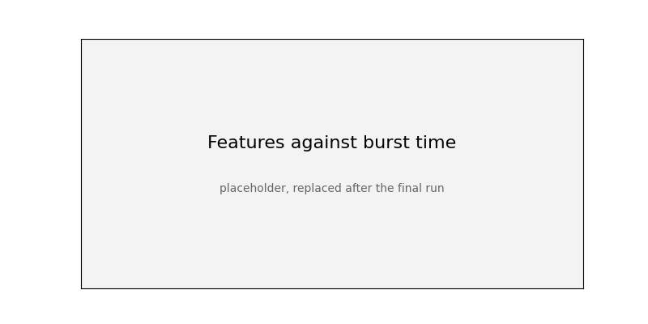
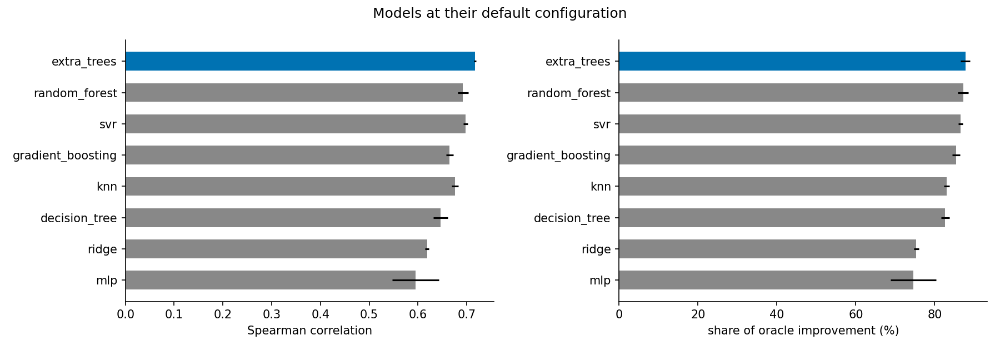
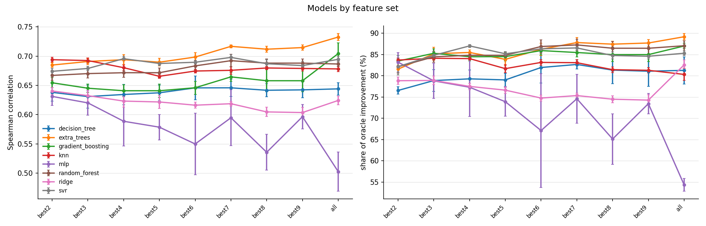
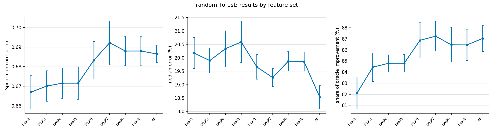
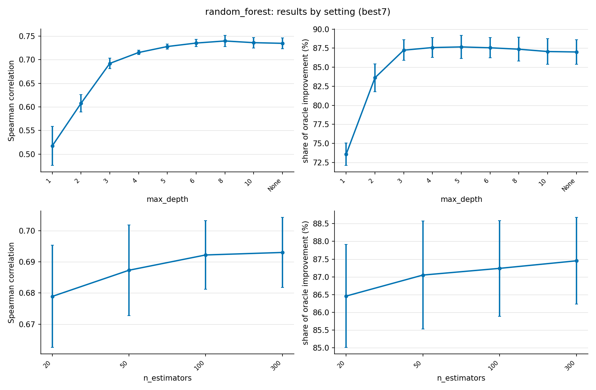

# Predicting CPU Burst Time from LLVM Static Features

This project asks whether the CPU burst time of a program can be predicted before it runs, using only features computed at compile time, and whether that prediction is good enough to drive a shortest-job-first (SJF) scheduler. The target platform is a small embedded core (RP2040 class), where the cost of a prediction must stay below the benefit of a better schedule.

The runner and models are documented in [docs/tool.md](docs/tool.md), and the dataset and result scripts in `tools/`. They are also available on their own on the `main` branch. The results below use the macOS dataset only; see [To do](#to-do).

## Contents

- [Approach](#approach)
- [Corpus](#corpus)
- [Dataset](#dataset)
- [Feature analysis](#feature-analysis)
- [Model results](#model-results)
- [Scheduling results](#scheduling-results)
- [Reproducing the results](#reproducing-the-results)
- [Repository contents](#repository-contents)
- [Limitations](#limitations)
- [Observations](#observations)
- [Conclusion](#conclusion)
- [To do](#to-do)

## Approach

1. Compile every program of a corpus to LLVM IR and extract 30 static features (instruction mix, loop structure, estimated trip counts, call graph shape, stack use, and similar properties).
2. Run every program and record its CPU time, which is the burst time.
3. Rank the features by relevance and redundancy (mRMR) and keep the best subset of each size from 2 to 9.
4. Train regression models on the logarithm of the burst time and evaluate them with repeated cross-validation, so that every prediction comes from a model that did not see the program.
5. Simulate scheduling: order random batches of programs by predicted burst time and compare the average waiting time with first-come-first-served (FIFO) and with the oracle, which sorts by the true burst time.

The oracle is the optimal order for average waiting time when all jobs are ready at once on one CPU. It is not a model. The score `oracle_pct` is the share of the oracle's improvement over FIFO that a model reaches.

## Corpus

The corpus has three sources. Only the synthetic programs are stored in this repository; the two public benchmark suites are third-party repositories that must be cloned.

| Source | Programs | Role | Link |
| --- | --- | --- | --- |
| TACLeBench | 57 | Labeled and used for training and evaluation | [github.com/tacle/tacle-bench](https://github.com/tacle/tacle-bench) |
| Embench IoT | 19 | Features only, these programs are not run | [github.com/embench/embench-iot](https://github.com/embench/embench-iot) |
| Synthetic | 320 | Labeled and used for training and evaluation, generated by `tools/gen_synth.py` | `corpus/synthetic/` |

The labeled corpus therefore has 377 programs (320 synthetic and 57 TACLeBench), and features exist for 396.

To restore the benchmark suites at the exact versions used:

```bash
git clone https://github.com/tacle/tacle-bench corpus/tacle-bench
git -C corpus/tacle-bench checkout c6a0d73e47bbd2bc86e34637156fb26dd4d5cf08

git clone https://github.com/embench/embench-iot corpus/embench-iot
git -C corpus/embench-iot checkout 09c2ed8c3b7008c95d08b038de4a3f6dc103ed70
```

Each suite keeps its own license; see the `COPYING` and `README` files in the cloned repositories.

## Dataset

The burst time of each program is its median CPU time over several inputs, measured with each program running alone on macOS. macOS provides no history features and no memory column, so the training set holds the 30 static features and the target.

| File | Content |
| --- | --- |
| `dataset/features.csv` | Static features of the 396 programs |
| `dataset/labels_macos.csv` | CPU time of each run |
| `dataset/macos/training_set.csv` | Features and target of the 377 labeled programs, built by `tools/build_training_set.py` |
| `dataset/macos/best_subsets.csv` | Best feature subset for each size from 2 to 9 |
| `dataset/v0_macos_archive/` | First version of the macOS dataset, kept for reference |

The folder also holds Linux and contended-load labels, which are not used in the results below.

## Feature analysis

Features are ranked with mRMR, which favors features that are correlated with the burst time and not correlated with the features already chosen. For each size `m` from 2 to 9 the best subset is found by exhaustive search over all combinations of that size.





The selected subsets:

| m | Features |
| --- | --- |
| 2 | max_loop_depth, bitops |
| 3 | max_loop_depth, n_allocas, bitops |
| 4 | max_loop_depth, n_allocas, divrems, bitops |
| 5 | max_loop_depth, direct_recursion, n_allocas, divrems, bitops |
| 6 | n_funcs, max_loop_depth, direct_recursion, mutual_recursion, divrems, bitops |
| 7 | n_funcs, cyclomatic_max, max_loop_depth, direct_recursion, mutual_recursion, divrems, bitops |
| 8 | n_funcs, max_loop_depth, static_trip_loops, dyn_trip_loops, direct_recursion, mutual_recursion, divrems, bitops |
| 9 | n_funcs, max_loop_depth, static_trip_loops, dyn_trip_loops, direct_recursion, mutual_recursion, divrems, bitops, fpops |

The tables behind the figures are in `dataset/macos/`: `feature_relevance.csv`, `feature_redundancy_pairs.csv`, `feature_pairwise_full.csv`, `mrmr_ranking.csv` and `best_subsets.csv`.

## Model results

Eight model families are compared with the seven-feature subset `best7`, five-fold cross-validation, and five repeats with seeds 101, 202, 303, 404 and 505. Values are the mean over the repeats.

Metrics:

- `Spearman`: rank correlation between predicted and true burst. Ordering depends on this.
- `R2`: coefficient of determination on the log burst time.
- `Error`: median absolute percentage error of the predicted burst time.

| Model | Spearman | R2 | Error (%) |
| --- | --- | --- | --- |
| extra_trees | 0.717 | 0.573 | 17.8 |
| svr | 0.698 | 0.553 | 17.8 |
| random_forest | 0.692 | 0.537 | 19.3 |
| knn | 0.676 | 0.494 | 18.9 |
| gradient_boosting | 0.664 | 0.551 | 22.7 |
| decision_tree | 0.646 | 0.468 | 18.9 |
| ridge | 0.619 | 0.313 | 35.6 |
| mlp | 0.595 | -0.576 | 35.9 |



The negative R2 of the MLP means that on average its log predictions are worse than predicting the mean. Its ranking is still useful, which is why its Spearman correlation is not far below the others.

### How far off the burst prediction is

The median absolute error of the predicted burst time, next to the scheduling accuracy from the SJF simulator (share of the oracle's improvement). `best7`, default settings, mean over five repeats.

| Model | Median error (%) | SJF accuracy (%) |
| --- | --- | --- |
| extra_trees | 17.8 | 87.8 |
| random_forest | 19.3 | 87.2 |
| svr | 17.8 | 86.5 |
| gradient_boosting | 22.7 | 85.5 |
| knn | 18.9 | 83.1 |
| decision_tree | 18.9 | 82.6 |
| ridge | 35.6 | 75.3 |
| mlp | 35.9 | 74.6 |

### Feature sets

Extra trees across the feature sets, default settings:

| Feature set | Features | Spearman | R2 | Error (%) | Oracle share (%) |
| --- | --- | --- | --- | --- | --- |
| best2 | 2 | 0.685 | 0.463 | 18.9 | 81.6 |
| best3 | 3 | 0.691 | 0.510 | 18.7 | 85.2 |
| best4 | 4 | 0.694 | 0.523 | 18.5 | 85.5 |
| best5 | 5 | 0.690 | 0.507 | 19.1 | 83.8 |
| best6 | 6 | 0.698 | 0.540 | 17.5 | 86.2 |
| best7 | 7 | 0.717 | 0.573 | 17.8 | 87.8 |
| best8 | 8 | 0.712 | 0.592 | 18.7 | 87.4 |
| best9 | 9 | 0.715 | 0.589 | 19.0 | 87.7 |
| all | 30 | 0.733 | 0.639 | 16.7 | 89.2 |

Two features already give 81.6 percent of the oracle's improvement. The gain flattens after about seven features, and all 30 features are still slightly better than any subset. A small subset keeps the model cheap, which matters for the target hardware.





### Settings

Random forest on `best7`, one setting changed at a time, the rest at their defaults (100 trees, depth 3):

| max_depth | 1 | 2 | 3 (default) | 4 | 5 | 6 | 8 | 10 | None |
| --- | --- | --- | --- | --- | --- | --- | --- | --- | --- |
| Oracle share (%) | 73.6 | 83.6 | 87.2 | 87.6 | 87.7 | 87.6 | 87.4 | 87.1 | 87.0 |

Depth 1 and 2 clearly underfit. From depth 3 on, the scheduling result is flat within the variation between repeats (about 1.3 points), while the Spearman correlation keeps rising slightly up to depth 8. Increasing the number of trees from 20 to 300 changes the oracle share from 86.5 to 87.5.



## Scheduling results

`tools/sjf_simulator.py` draws 3000 random batches of 20 programs and reports, for each model, the waiting time under FIFO, under the model's order, and under the oracle. `wait_cut_pct` is the reduction compared with FIFO and `oracle_pct` is the share of the oracle's reduction that the model reaches. The standard deviation is over the five repeats.

| Model | Wait reduction vs FIFO (%) | Oracle share (%) | Std |
| --- | --- | --- | --- |
| extra_trees | 55.4 | 87.8 | 1.2 |
| random_forest | 55.0 | 87.2 | 1.3 |
| svr | 54.6 | 86.5 | 0.5 |
| gradient_boosting | 53.9 | 85.5 | 1.0 |
| knn | 52.4 | 83.1 | 0.7 |
| decision_tree | 52.1 | 82.6 | 1.1 |
| ridge | 47.5 | 75.3 | 0.6 |
| mlp | 47.0 | 74.6 | 5.7 |

The full table is `models/results/macos/main/sjf_models.csv`. Batches of 5, 10, 20 and 50 programs give nearly the same percentages for the best models (`sjf_workloads.csv` in each model folder).

## Reproducing the results

Install the requirements and LLVM as described in [docs/tool.md](docs/tool.md), then restore the benchmark suites as shown above. The features and labels are already stored, so the pipeline starts from the training set:

```bash
python tools/build_training_set.py macos
python tools/select_features.py macos

python runner.py check configs/macos_all.yml
python runner.py configs/macos_all.yml

python tools/sjf_simulator.py models/results/macos/main
python tools/plot_results.py models/results/macos/main
```

The run configuration is `configs/macos_all.yml`. To rebuild the data from the source programs: `tools/extract_features.py`, then `tools/collect_labels.py macos`.

The images in `docs/images/` are copies of the generated plots:

| Image | Source |
| --- | --- |
| `feature_correlation_heatmap.png` | `dataset/macos/plots/feature_correlation_heatmap.png` |
| `feature_vs_target.png` | `dataset/macos/plots/feature_vs_target_grid.png` |
| `model_comparison.png` | `models/results/macos/main/model_comparison.png` |
| `feature_comparison.png` | `models/results/macos/main/feature_comparison.png` |
| `rf_by_features.png` | `models/results/macos/main/random_forest/by_features.png` |
| `rf_by_settings.png` | `models/results/macos/main/random_forest/by_settings.png` |

## Repository contents

```
runner.py       model runner
models/         model families and the evaluation code
tools/          corpus, feature, label, selection, simulation and plotting tools
configs/        run configurations
corpus/         synthetic programs (benchmark suites are cloned separately)
dataset/        features, labels, training sets and feature rankings
docs/           tool reference and result images
archive/        scripts and result tables of the first version, kept for reference
paper/          figures from the first version of the analysis
features.md     lab notebook with the feature design and decisions
```

## Limitations

- Feature selection is computed on the whole dataset before cross-validation, which leaks a small amount of information into the evaluation.
- The corpus is small and mostly synthetic, so results on real programs may differ.
- Embench programs are used for features only and have no labels.
- Burst times are measured on a desktop-class machine, not on the target microcontroller.
- Programs run alone, so the results do not cover scheduling under contention.
- Results in `archive/results_v1` and the figures in `paper/` come from an earlier version of the pipeline and may not match the current runs.

## Observations

All numbers are from the macOS results above.

- **The prediction can be far off and the schedule still good.** Extra trees has a median error of 17.8% and recovers 87.8% of the oracle's improvement. The MLP has a median error of 35.9% and a negative R2, and still recovers 74.6%. Both cut the average wait compared with FIFO, by 55.4% and 47.0%. SJF uses only the order of the jobs, and swapping two programs with similar bursts costs almost nothing.
- **The error does not predict the schedule.** Gradient boosting has a larger median error (22.7%) than k-nearest neighbors (18.9%) and the decision tree (18.9%), yet a better SJF accuracy (85.5% against 83.1% and 82.6%).
- **The rank correlation tracks the schedule only roughly.** The top models (extra trees, random forest, SVR) and the bottom ones (ridge, MLP) are the same by either measure. In the middle the two disagree, for example gradient boosting has a lower Spearman than k-nearest neighbors (0.664 against 0.676) but a better scheduling result. The correlation is computed over all 377 programs, while the scheduler only orders batches of 20.
- **The three best models are close.** Extra trees, random forest and SVR are within 1.3 points of each other, which is about the standard deviation over repeats (0.5 to 1.3). They cannot be separated with these five repeats.
- **The MLP is unstable.** Its standard deviation over repeats is 5.7 points, against about 1 for the others.
- **Few features are enough.** For extra trees, two features give 81.6% of the oracle's improvement, seven give 87.8%, and all 30 give 89.2%. For random forest the result is flat from six features on (86.5% to 87.2%).
- **Depth matters only at the start.** Random forest at depth 1 or 2 underfits (73.6% and 83.6%). From depth 3 to unlimited depth the result stays between 87.0% and 87.7%.

## Conclusion

- A good schedule does not require an accurate burst prediction. The scheduling result depends on the order of the predictions, and models with a median error of 18% to 36% still cut the average wait by 47% to 55% compared with FIFO.
- Tree ensembles (extra trees and random forest) and SVR are the best models, at 86.5% to 87.8% of the oracle's improvement. Ridge and the MLP are clearly worse, at about 75%.
- A few features carry most of the value, which keeps the model small. This matters on a microcontroller.
- The best result leaves about 12% of the oracle's improvement unused, and all models are evaluated on one machine with programs running alone.

## To do

- Try to use history. Add the history features (`hist_burst_log`, `hist_maxrss`, taken from one earlier run of the same program) by running the Linux dataset, where they exist, with feature sets such as `best7+history`. Then regenerate the images and update this README.
